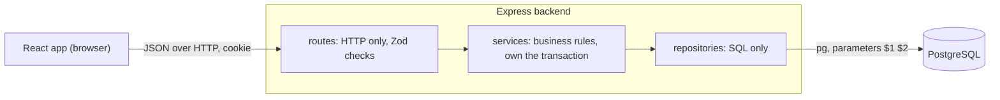
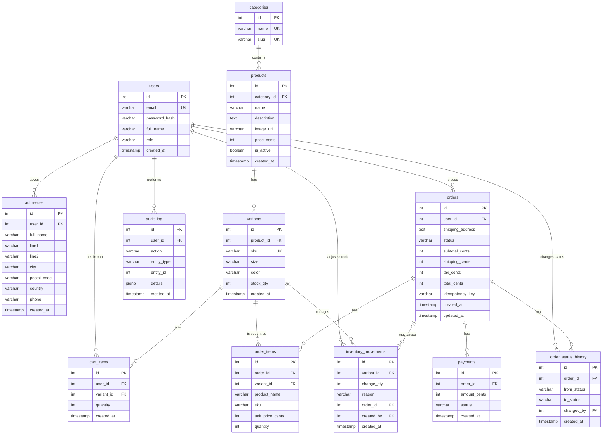

# Threadnest

Threadnest is a small online shop for everyday clothing basics (T-shirts, hoodies, caps, tote bags, socks).
Customers register, search and filter products, fill a cart, check out with a simulated card payment and
track their orders. Admins manage products and stock, move orders through their life, and see a sales
dashboard and an audit log.

It was built for a company assessment. The goal was a small but correct system: the rules that matter
(stock, duplicate orders, order status, permissions, audit) are enforced by the server and the database
and proved by automated tests.

## Tech stack

| Part | Choice |
|---|---|
| Backend | Node.js 22, Express 5, plain JavaScript (ES modules) |
| Database | PostgreSQL 16 (Docker), `pg` driver, plain SQL, numbered migrations |
| Validation | Zod on every body, query and route parameter |
| Security | bcryptjs, JWT in an httpOnly cookie, helmet, CORS allowlist, login rate limit |
| Backend tests | Vitest and Supertest (their own database `threadnest_test`) |
| API docs | OpenAPI 3 (`backend/openapi.yaml`) shown with Swagger UI at `/api/docs` |
| Frontend | React 19, Vite, React Router, Tailwind CSS v4 |

## Architecture

The backend is a modular monolith: one Node process, one database, one folder per feature
(`auth`, `catalog`, `cart`, `addresses`, `orders`, `payments`, `admin`, `audit`). Each module has the same
layers, and a layer only talks to the one below it.



How one request flows, using checkout as the example:

1. `helmet`, `cors`, `express.json` and `cookie-parser` run first (`backend/src/app.js`).
2. `authenticate` turns the login cookie into `req.user` (`middleware/authenticate.js`).
3. The route checks the body and the `Idempotency-Key` header with Zod (`orders.routes.js`, `orders.schema.js`).
4. The service opens one database transaction and does all the work (`orders.service.js`).
5. The repositories run the SQL, always with parameters (`orders.repo.js`).
6. Any `AppError` or Zod error ends up in one `errorHandler`, which sends
   `{ "error": { "code", "message", "details" } }` with the right status.

## Folder structure

```
ThreadNest/
  backend/                 Node + Express, own package.json
    src/
      app.js server.js     the Express app, and the file that starts it
      config/              env.js (settings from .env), shop.js (shipping, tax, limits)
      db/                  migrations/ (001 to 006), migrate.js, pool.js, seed*.js, createTestDb.js
      lib/                 AppError, orderStateMachine, pricing, revenue, token, schemas, sqlFilter
      middleware/          authenticate, requireRole, loginLimiter, errorHandler
      modules/             auth, catalog, cart, addresses, orders, payments, audit, admin
                           (each: *.routes.js, *.service.js, *.repo.js, *.schema.js)
    tests/                 api/ (Supertest), unit/ (pure functions), helpers.js, globalSetup.js
    openapi.yaml           the API description
  frontend/                React + Vite + Tailwind, own package.json
    src/                   api.js, App.jsx, context/, components/, pages/, pages/admin/
  docker-compose.yml       PostgreSQL for development
  .env.example             all settings with dummy values
```

## Setup

You need Node.js 20.6 or newer (it was built with 22), npm and Docker.

```bash
# 1. Settings. On Windows PowerShell use: copy .env.example .env
cp .env.example .env

# 2. Start PostgreSQL in Docker
docker compose up -d

# 3. Install the libraries
cd backend && npm install
cd ../frontend && npm install

# 4. Create the tables and the demo data (run these in backend/)
cd ../backend
npm run migrate
npm run seed

# 5. Start the backend (http://localhost:3000)
npm run dev

# 6. In a second terminal, start the frontend (http://localhost:5173)
cd frontend && npm run dev
```

Open http://localhost:5173. The Vite dev server forwards `/api` to the backend, so login cookies just work.

**If port 5432 is already taken** (for example by a PostgreSQL installed on Windows), the migration fails with
"password authentication failed", because it talks to the other server. Change the port in `.env` in two
places, then run `docker compose up -d` again: `POSTGRES_PORT=5433` and the same port inside `DATABASE_URL`.

**Production style run:** `cd frontend && npm run build`, then `cd backend && NODE_ENV=production npm start`.
Express then serves the built React app and the API on http://localhost:3000.

## Environment variables

All of them are in `.env` in the project root (copy `.env.example`). The backend loads that file with
`node --env-file=../.env`. Never commit `.env`.

| Variable | Used by | Meaning |
|---|---|---|
| `SHOP_NAME` | backend, shown in the navbar | The shop name (Threadnest) |
| `POSTGRES_USER`, `POSTGRES_PASSWORD`, `POSTGRES_DB` | docker-compose | Login of the database container |
| `POSTGRES_PORT` | docker-compose | Port on your computer (default 5432) |
| `DATABASE_URL` | backend | Connection string. It must repeat the user, password, port and database above |
| `PORT` | backend | API port (default 3000) |
| `FRONTEND_ORIGIN` | backend | The one origin allowed by CORS (default http://localhost:5173) |
| `LOGIN_RATE_LIMIT_MAX` | backend | Login attempts per IP per 15 minutes (default 20) |
| `JWT_SECRET` | backend | Signs the login token. Use a long random value in a real `.env` |

## Demo credentials (dummy data only)

| Account | Email | Password |
|---|---|---|
| Admin | `admin@threadnest.test` | `Password123!` |
| Customer | `customer@threadnest.test` | `Password123!` |

Simulated cards for the payment step: `4242 4242 4242 4242` is approved, `4000 0000 0000 0002` is declined.
No real card data is ever used or stored.

## Database setup and migrations

The schema is plain SQL in `backend/src/db/migrations`, numbered `001` to `006`. `npm run migrate` runs
`src/db/migrate.js`, a small runner: it runs the files in name order, each inside its own transaction together
with a row in the `schema_migrations` table, and skips files that already ran. So it is safe to run twice, and
a failing file leaves nothing half built. Old migrations are never edited; changes go in a new file.

`npm run seed` fills 5 categories, 30 products (123 variants), the two demo accounts and 8 sample orders so the
dashboard is not empty. It is safe to run twice. **It deletes users, orders and the catalogue first**
(`TRUNCATE`), so use it only on a demo database. Three variants have special stock: two with 1 left and
one sold out, so the stock rules are easy to try.

Rules are kept in the database as well as in the code: `UNIQUE` email and SKU, `CHECK (stock_qty >= 0)`,
`CHECK` lists for roles and statuses, foreign keys everywhere, and `UNIQUE (user_id, idempotency_key)` on orders.

## ER diagram

This diagram matches the migrations column for column (it was checked against the live database).
`PK` is a primary key, `FK` a foreign key, `UK` a unique column. Two more unique rules: `cart_items` is unique on
`(user_id, variant_id)` and `orders` is unique on `(user_id, idempotency_key)`.



The table `schema_migrations` (file name and time) belongs to the migration runner and is not part of the shop.

## API documentation

Start the backend and open **http://localhost:3000/api/docs**. It is generated from
[`backend/openapi.yaml`](backend/openapi.yaml), which describes all 37 endpoints. A test fails if a route is
added without documenting it. Log in first (`POST /api/auth/login`) and the browser sends the cookie.

Conventions: money is an integer in paise (`*_cents`, 49900 = Rs 499.00); the UI shows rupees. Resource fields use the
database column names; only `addressId`, `variantId` and a few query parameters are camelCase.
Status codes: 400 validation, 401 not logged in, 403 wrong role, 404 not found, 409 conflict, 429 too many logins.

## Tests

```bash
cd backend
npm test
```

The tests use their own database `threadnest_test`. `tests/globalSetup.js` creates it if needed and runs the
migrations on it (`src/db/createTestDb.js`), so they never touch your demo data. Test files share that
database, so they run one after another. The frontend has no automated tests; check it with
`cd frontend && npm run build` and by using the app.

Result of the last run (`Test Files 20 passed (20), Tests 237 passed (237)`):

| Test file | Passed |
|---|---|
| `tests/api/addresses.test.js` | 6 / 6 |
| `tests/api/adminOrders.test.js` | 13 / 13 |
| `tests/api/adminProducts.test.js` | 16 / 16 |
| `tests/api/auth.test.js` | 10 / 10 |
| `tests/api/cancel.test.js` | 7 / 7 |
| `tests/api/cart.test.js` | 14 / 14 |
| `tests/api/catalog.test.js` | 12 / 12 |
| `tests/api/checkout.test.js` | 8 / 8 |
| `tests/api/docs.test.js` | 3 / 3 |
| `tests/api/health.test.js` | 2 / 2 |
| `tests/api/idempotency.test.js` | 4 / 4 |
| `tests/api/orders.test.js` | 7 / 7 |
| `tests/api/payment.test.js` | 8 / 8 |
| `tests/api/rateLimit.test.js` | 2 / 2 |
| `tests/api/rbac.test.js` | 53 / 53 |
| `tests/api/reports.test.js` | 9 / 9 |
| `tests/api/security.test.js` | 11 / 11 |
| `tests/api/stock.test.js` | 4 / 4 |
| `tests/unit/orderStateMachine.test.js` | 40 / 40 |
| `tests/unit/pricing.test.js` | 8 / 8 |

## The five rules and how each is enforced

| # | Rule | Where it is enforced | Test that proves it |
|---|---|---|---|
| 1 | Stock never goes negative | `decreaseStock` in `modules/orders/orders.repo.js`: `UPDATE variants SET stock_qty = stock_qty - $1 WHERE id = $2 AND stock_qty >= $1 RETURNING id`, called for each cart line (in `variant_id` order) inside the checkout transaction. No row back means 409 `OUT_OF_STOCK` and everything rolls back. `CHECK (stock_qty >= 0)` is the backstop. Admin stock changes use the same idea (`changeStockBy`). | `stock.test.js`: two buyers for the last item at the same moment give one 201 and one 409, stock ends at 0 |
| 2 | A repeated checkout creates one order | The browser makes one UUID per checkout page visit and sends it as `Idempotency-Key`. `insertOrder` uses `ON CONFLICT (user_id, idempotency_key) DO NOTHING RETURNING id` and runs before any stock change. No id back means "already done": the existing order is returned with 200 | `idempotency.test.js`: 5 identical parallel checkouts give one order, one stock drop, one order id |
| 3 | Only allowed status changes | `lib/orderStateMachine.js` holds the allowed moves as data. `applyStatusChange` in `modules/orders/orderStatus.service.js` checks it, then runs `UPDATE orders SET status = new WHERE id = $1 AND status = old` and requires one changed row. Illegal move: 409 `INVALID_TRANSITION`. Pay, cancel and the admin status endpoint all use this one function | `orderStateMachine.test.js` (all 36 pairs), `cancel.test.js`, `adminOrders.test.js` |
| 4 | Authorization on the server | `authenticate` (cookie to `req.user`, reloaded from the database) and `requireRole('admin')` are mounted once on the whole admin router (`modules/admin/admin.routes.js`). Customer routes add `AND user_id = $currentUser`, so other people's data is 404. The role is never read from a request body. No query selects `password_hash` except login | `rbac.test.js` (every admin route as nobody, customer, admin), `security.test.js`, `orders.test.js` |
| 5 | Audit and reports | `recordAudit` is called with the same transaction client as the action (order placed, paid, cancelled, every status change, product create, update, deactivate, stock adjustment). Dashboard numbers are SQL over the `orders` and `order_items` tables | `reports.test.js`: revenue equals the order items plus shipping and tax, counts match the orders list, an audit row exists after each admin action |

Every stock change also writes an `inventory_movements` row, so starting stock plus the sum of the changes equals the
current stock (checked in `cancel.test.js`).

## Design decisions

- **Modular monolith.** One deployable process with one folder per feature is the simplest thing that keeps the code
  organised. Splitting into services would add network calls, separate databases and failure modes this shop does not need.
- **PostgreSQL.** The shop needs transactions, constraints and joins. The two rules that matter most (no negative stock,
  one order per key) are database features: a conditional `UPDATE` and a `UNIQUE` index.
- **Plain SQL with a tiny migration runner.** No ORM, so every query is visible and explainable. Numbered files and a
  `schema_migrations` table are enough for a project of this size.
- **Variants.** A customer buys a size and colour, not "a T-shirt". Stock and SKU live on the variant; name, description
  and price live on the product. One price per product keeps sorting and pricing simple; the cost is that sizes of one
  product cannot have different prices.
- **Integer money.** Prices are whole paise, so there are no floating point rounding errors. `lib/pricing.js` is a pure
  function with tests; tax is rounded half up with integer arithmetic.
- **Snapshots in orders.** An order copies the address, product name, SKU and unit price. Later changes to the catalogue
  or the address book never rewrite history.
- **Idempotency keys.** A double click or a network retry must not charge or ship twice. The key is made once when the
  checkout page opens and enforced by a database unique index, so it is safe even for simultaneous requests.
- **Stock ledger.** `variants.stock_qty` says how much is left; `inventory_movements` says why. Reports and tests can
  prove the number is right instead of trusting it.
- **One place for status changes.** Pay, cancel and admin changes all call `applyStatusChange`, so the rules, the
  history row, the audit row and the restock/refund logic cannot drift apart.
- **Cookie login.** The JWT lives in an httpOnly, SameSite=Lax cookie (Secure in production), so scripts in the page
  cannot steal it. It holds only the user id; the role is read from the database on every request.
- **Declined card is not an error.** `POST /api/orders/:id/pay` answers 200 with `payment.status: "failed"`, saves a
  failed payment row and leaves the order `placed`, so the customer can retry or cancel.
- **Search with ILIKE.** Product search matches the name, description and category name with `ILIKE`. It is easy to
  read and finds "shirt" in the category "T-shirts"; a full-text index would be faster on a large catalogue.

## Known limitations

- Payments are simulated. There is no real payment provider, no 3-D Secure, no refunds to a real card.
- No email, no password reset, no email verification.
- No image upload: product images are placeholder URLs from `placehold.co` and need internet access.
- The audit log is not tamper-proof: anyone with database access can change rows. There is no hash chain.
- Logging out clears the cookie, but a stolen token stays valid until it expires (7 days). There are no refresh tokens
  or token revocation list.
- The login rate limit is kept in the memory of one process. With several servers it would need a shared store, and
  behind a proxy `trust proxy` must be configured.
- Stock is taken at checkout, not when an item is put in the cart, and an unpaid order is not cancelled automatically.
- One currency (rupees), one flat shipping fee, one tax rate, no coupons.
- Search uses `ILIKE`, not a full-text index, and has no ranking.
- The React screens have no automated browser tests. They were checked by building the app, by the API tests behind
  them, and by a static accessibility check (labels, alt text, button text); keyboard navigation, screen readers and
  the layouts at 375, 768 and 1280 px were designed with Tailwind breakpoints but still need a manual check.
- The admin order page shows no order details (items, address); it only lists orders and the legal next buttons.

